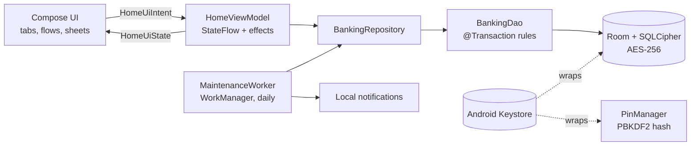

# Architecture

PocketPay is a single-module Android app organised as Clean Architecture with an MVI presentation layer.
Everything runs on the device: there is no backend, and all money is simulated.

## Layers and packages

| Package | Responsibility |
|---|---|
| `ui/theme`, `ui/components` | Design tokens (light/dark), shapes, typography and reusable widgets: hero card, pill buttons, floating bottom bar, PIN keypad, bar chart, success badge |
| `presentation/home` | The app shell (`HomeScreen`), tabs (`HomeTab`, `StatsAndPocketsTabs`, `ProfileAndHistory`), flows (`PaymentFlow`, `EntryScreens`) and bottom sheets (`Sheets`). Screens are stateless; `HomeScreen` is the only place that talks to the ViewModel |
| `presentation/scanner` | CameraX + ML Kit QR scanner, gallery scan, QRIS validation |
| `presentation/security` | `PinManager`, `BiometricHelper`, `Vault` (Keystore cipher) |
| `presentation/statement` | PDF e-statement generator (multi-page, share/open via FileProvider) |
| `domain/qris` | EMVCo/QRIS parser and builder with CRC-16 |
| `domain/stats` | Weekly/monthly income and expense buckets |
| `domain/notify` | Milestone detection (deposit matured, goal reached) |
| `data` | Room entities, `BankingDao`, `EncryptedDatabase`, typed `BankingError`, `ProfileStore` |
| `work` | `MaintenanceWorker` (daily interest + notifications) |
| `di` | Hilt modules |

## Presentation: MVI

* The UI emits immutable `HomeUiIntent`s and renders a single `HomeUiState` collected from a `StateFlow`.
* One-off events (toasts) go through a buffered `Channel` exposed as `HomeUiEffect`.
* Full-screen flows (scan, payment, PIN, success, receive QR) are layered over the tabs. Each overlay swallows
  touches and hides the screens beneath it from accessibility services, so nothing underneath can be tapped or read through it.

## Data and money rules

* **Atomic operations.** Every multi-step money movement is a single Room `@Transaction` in `BankingDao`.
* **Fresh reads.** Each transaction re-reads the account and pocket rows inside the transaction instead of trusting
  objects passed in by the UI, so a stale screen can never overspend.
* **Integer money.** Balances are `Long` rupiah. Interest uses `BigDecimal` rounded down to avoid floating-point drift.
* **Typed errors.** Rule violations throw `BankingException(BankingError)`. The UI maps each code to a localized
  message; unknown exceptions show a generic message instead of leaking internals.
* **Idempotency.** Each payment gets a UUID used as the transaction id (`OnConflictStrategy.ABORT`), and the ViewModel
  ignores a second payment while one is in flight.

## Persistence and migrations

* Room schema version 7, schemas exported to `app/schemas` for migration testing.
* Real migrations (5→6 adds `lastInterestAt`, 6→7 adds `targetAmount`) keep user data; there is no destructive fallback.
* `EncryptedDatabase` opens the database with SQLCipher. A random passphrase is generated once and stored only as an
  AES-GCM blob protected by an Android Keystore key. Databases created by older, unencrypted versions are converted
  in place on first launch.

## Background work

`MaintenanceWorker` runs once a day through WorkManager (on-demand initialisation). It credits interest even if the app
was not opened, then posts private local notifications for matured deposits and reached savings goals. The lock screen
only shows a generic line; details appear after unlocking.

## Design system

Colours are semantic roles (`PocketColors`: hero, lime, soft, danger, …) provided through a `CompositionLocal` next to
Material's `ColorScheme`, so every screen works in light and dark without hard-coded hex values. All UI text lives in
`strings.xml` (Indonesian default, English translation); a unit test keeps both files in sync.
